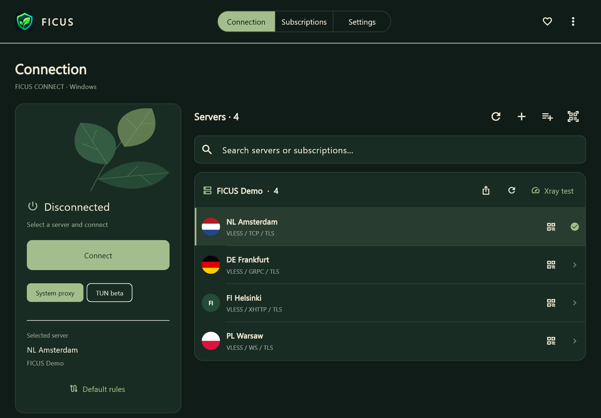

  

<h1 align="center">FICUS Connect</h1>

A quieter way to connect.

  
  
  
  

<b>English</b> · <a href="README.ru.md">Русский</a>

  <a href="https://github.com/AnonymousFS/FICUS-Connect/releases/download/v0.9.2-beta/FICUS-Connect-0.9.2-beta-Windows-x64-Setup.exe"><b>Download for Windows</b></a>
  &nbsp; · &nbsp;
  <a href="https://github.com/AnonymousFS/FICUS-Connect/releases/download/v0.9.4-beta/FICUS-Connect-0.9.4-beta-android-arm64.apk"><b>Download for Android</b></a>
  &nbsp; · &nbsp;
  <a href="https://github.com/AnonymousFS/FICUS-Connect/releases">All releases</a>
  &nbsp; · &nbsp;
  <a href="https://donatty.com/ficusapp">Support FICUS</a>

> **Beta — actively in development.** Features and behavior may change. TUN and Kill Switch are experimental; real-world interruption and leak protection have not been fully validated. Please keep a backup of your settings before updating.

FICUS Connect is a Windows and Android proxy/VPN client built with Flutter, using Xray-core and sing-box. Its restrained botanical interface keeps your subscriptions, servers and connection controls together.

This repository hosts **downloads, documentation and release information**. FICUS application source code and private debug symbols are not published here.

## Downloads

| Platform | Status | Download |
| --- | --- | --- |
| Windows 10/11 · x64 | **Available · 0.9.2 beta** | [Installer](https://github.com/AnonymousFS/FICUS-Connect/releases/download/v0.9.2-beta/FICUS-Connect-0.9.2-beta-Windows-x64-Setup.exe) · [SHA256](https://github.com/AnonymousFS/FICUS-Connect/releases/download/v0.9.2-beta/FICUS-Connect-0.9.2-beta-Windows-x64-Setup.exe.sha256) |
| Android 7.0+ · ARM64 | **Available · 0.9.4 beta** | [APK](https://github.com/AnonymousFS/FICUS-Connect/releases/download/v0.9.4-beta/FICUS-Connect-0.9.4-beta-android-arm64.apk) · [SHA256](https://github.com/AnonymousFS/FICUS-Connect/releases/download/v0.9.4-beta/FICUS-Connect-0.9.4-beta-android-arm64.apk.sha256) |
| iOS | Planned | Not released |
| Linux | Planned | Not released |
| macOS | Planned | Not released |

Ports to iOS, Linux and macOS remain on the roadmap without release dates. A dedicated Android TV / Apple TV receiver is a future project; current builds can send subscriptions to compatible INCY/HAPP TV clients.

### Android beta

Install the ARM64 APK, add your own subscription or servers, choose a server on **Connection**, and approve Android's VPN request. You can update over the earlier signed Android betas without clearing app data. Version 0.9.4 fixes Xray's GeoIP/GeoSite preparation; a working connection has been confirmed by a tester on Android 16. Broader device and protocol testing continues.

The Android beta supports multiple subscriptions, Xray/sing-box selection by node, editable DNS/domain/IP routing, connection sharing and QR import from an image. Camera QR scanning, per-app routing and background subscription scheduling are not implemented. Windows firewall/Kill Switch and desktop settings do not apply to Android.

[Separate sing-box runtime sources and build instructions](https://github.com/AnonymousFS/FICUS-Connect/releases/download/v0.9.4-beta/FICUS-Android-Runtime-Sources-0.9.4.tar.gz) are provided under their component licenses. This archive does not contain the private FICUS application source tree. See [third-party notices](THIRD_PARTY.md).

## Getting started on Windows

Version **0.9.2 beta** fixes country flags in server avatars, keeps the ficus illustration proportional, and corrects the installer version information. See the [release notes](https://github.com/AnonymousFS/FICUS-Connect/releases/tag/v0.9.2-beta).

1. Download and run the Windows x64 installer. Minimum OS: Windows 10 1809; Windows 11 is supported. ARM64 has not been tested.
2. Open FICUS and add your own HTTPS subscription, import server links/JSON, or import a QR image.
3. Choose a server on **Connection**, select the connection mode, and connect.

The installer includes the app, Xray, sing-box, NaiveProxy's runtime library and the required C++ runtime. No component download is needed during installation. Installation is per user; TUN and firewall changes request Windows administrator approval separately. The build is currently **unsigned**, so Windows may show an unknown-publisher warning. SHA256 verifies file integrity; it does not replace a publisher signature.

## Features

| Area | Available in the Windows beta |
| --- | --- |
| Subscriptions | Multiple subscriptions, refresh scheduling and grouped servers on the connection screen |
| Import | Share links, Base64 lists, Xray/sing-box JSON, QR from an image file |
| Share | Copy a subscription/server link, display or save its QR code |
| Television | Subscription transfer by pairing code to INCY or HAPP; physical-TV interoperability still needs testing |
| Network | System proxy, local HTTP/SOCKS proxy, experimental TUN |
| DNS & routing | Editable DNS, domain/IP rules, direct/proxy/block actions, per-app TUN rules |
| Transport options | gRPC, WebSocket, HTTPUpgrade, XHTTP/SplitHTTP, RAW/TCP, mKCP and protocol-specific QUIC transports |
| Desktop | Tray, startup options, RU/EN interface, interface scale and several botanical themes |
| Diagnostics | Core logs, measured latency, traffic counters and session history |

**Protocols:** VLESS with TLS/REALITY, VMess, Trojan, Shadowsocks, HTTP/HTTPS, SOCKS, WireGuard, Hysteria 1/2, TUIC, AnyTLS, NaiveProxy, SSH and Snell. OpenVPN/OpenConnect endpoints are available through compatible sing-box JSON. Availability depends on core support and the supplied configuration. SIP003 plugins, ShadowsocksR and native PPTP/L2TP/IPsec are not integrated. Chains and secondary XHTTP download endpoints currently require proxy mode.

## Privacy and source protection

- The public release contains no configured account, personal subscription, server credentials, session configuration or developer settings. Add your own connection details after installation.
- Subscriptions and settings are stored separately from the application using Windows DPAPI or Android platform secure storage. Android cloud backup is disabled.
- The release payload is restricted to an explicit file list and compared locally against known private credentials before publication. Debug symbols remain private; Dart code is obfuscated. This does **not** make a downloadable binary impossible to reverse engineer.
- Sharing is explicit. A QR/link grants access to its recipient. INCY transfer encrypts the subscription before relay; HAPP Web Import receives the link through its own service. See [Privacy](PRIVACY.md).
- Windows includes separate upstream Xray/sing-box executables, source archives, licenses and a readable PowerShell TUN helper. Android uses the protected-socket Xray SDK and a separate sing-box runtime; its runtime sources and build instructions accompany the APK. See [component notices](THIRD_PARTY.md). The FICUS application source remains private.

## Roadmap

- Improve stability and real-world testing of the Windows beta.
- Validate TV transfers and expand import compatibility.
- Stabilize the Android beta and port FICUS Connect to **iOS, Linux and macOS**.
- Explore a dedicated TV receiver after the mobile/TV application is developed.

Planned work is not a promise of a release date or a feature already available today.

## Feedback

Use [GitHub Issues](https://github.com/AnonymousFS/FICUS-Connect/issues) for reproducible bugs and feature requests. Include your FICUS version, operating system version, device model, steps to reproduce, and expected/actual behavior. **Never attach subscription URLs, server keys, passwords, encrypted backups or unredacted logs/screenshots.** See [Security](SECURITY.md).

## Support FICUS

If FICUS is useful to you, you can support its development through [Donatty](https://donatty.com/ficusapp).

## Components and distribution

[Xray-core](https://github.com/XTLS/Xray-core) · [sing-box](https://github.com/SagerNet/sing-box) · [Flutter](https://flutter.dev) · [Third-party notices](THIRD_PARTY.md) · [Distribution notes](DISTRIBUTION.md)

FICUS Connect is a client. It does not include a VPN subscription or operate the user's VPN server. Supply your own compatible configuration. FICUS is an independent project and is not affiliated with INCY or HAPP.
