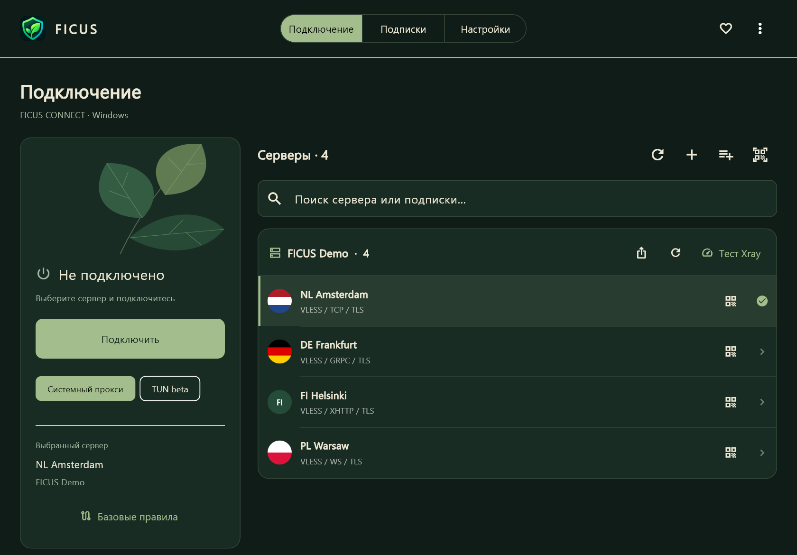

  

<h1 align="center">FICUS Connect</h1>

Подключение без лишнего шума.

  
  
  

<a href="README.md">English</a> · <b>Русский</b>

  <a href="https://github.com/AnonymousFS/FICUS-Connect/releases/download/v0.9.2-beta/FICUS-Connect-0.9.2-beta-Windows-x64-Setup.exe"><b>Скачать для Windows</b></a>
  &nbsp; · &nbsp;
  <a href="https://github.com/AnonymousFS/FICUS-Connect/releases">Все версии</a>
  &nbsp; · &nbsp;
  <a href="https://donatty.com/ficusapp">Поддержать FICUS</a>

> **Бета-версия — приложение активно разрабатывается.** Функции и поведение могут меняться. TUN и Kill Switch экспериментальны: защита при реальных обрывах и от утечек ещё не прошла полную проверку. Перед обновлением сохраняйте резервную копию настроек.

FICUS Connect — клиент для Windows на Flutter с ядрами Xray-core и sing-box. Строгий растительный интерфейс объединяет подписки, серверы и управление подключением на одном экране.

Этот репозиторий содержит **установщики, документацию и информацию о выпусках**. Исходники приложения FICUS и приватные отладочные символы здесь не публикуются.

## Скачать

| Платформа | Состояние | Загрузка |
| --- | --- | --- |
| Windows 10/11 · x64 | **Доступно · бета** | [Установщик](https://github.com/AnonymousFS/FICUS-Connect/releases/download/v0.9.2-beta/FICUS-Connect-0.9.2-beta-Windows-x64-Setup.exe) · [SHA256](https://github.com/AnonymousFS/FICUS-Connect/releases/download/v0.9.2-beta/FICUS-Connect-0.9.2-beta-Windows-x64-Setup.exe.sha256) |
| Android | В планах | Пока не выпущено |
| iOS | В планах | Пока не выпущено |
| Linux | В планах | Пока не выпущено |
| macOS | В планах | Пока не выпущено |

В дальнейшем планируем перенести приложение на Android, iOS, Linux и macOS. Даты пока не определены. Собственная версия FICUS для Android TV / Apple TV — будущий проект; сейчас Windows-клиент умеет отправлять подписки в совместимые INCY/HAPP на телевизоре.

## Начало работы

В **0.9.2 beta** исправлены флаги внутри значков серверов, пропорции рисунка фикуса и отображение версии в установщике. Подробнее — в [описании выпуска](https://github.com/AnonymousFS/FICUS-Connect/releases/tag/v0.9.2-beta).

1. Скачайте и запустите установщик Windows x64. Минимальная ОС — Windows 10 1809; Windows 11 поддерживается. ARM64 отдельно не проверялся.
2. Откройте FICUS и добавьте собственную HTTPS-подписку, импортируйте ссылки/JSON серверов либо изображение QR-кода.
3. На экране **«Подключение»** выберите сервер, режим работы и подключитесь.

Установщик включает приложение, Xray, sing-box, библиотеку NaiveProxy и необходимые библиотеки C++. Дополнительные компоненты во время установки не скачиваются. Установка выполняется для текущего пользователя; TUN и изменения брандмауэра отдельно запрашивают подтверждение администратора Windows. У сборки пока **нет цифровой подписи**, поэтому Windows может показать предупреждение о неизвестном издателе. SHA256 проверяет целостность файла, но не заменяет подпись издателя.

## Возможности

| Раздел | Доступно в Windows-бете |
| --- | --- |
| Подписки | Несколько подписок, обновление по расписанию, группы серверов на главном экране |
| Импорт | Ссылки подключения, Base64-списки, JSON Xray/sing-box, QR из файла |
| Поделиться | Копирование ссылки подписки/сервера, показ и сохранение QR-кода |
| Телевизор | Отправка подписки по коду в INCY или HAPP; совместимость с физическими ТВ ещё нужно проверить |
| Сеть | Системный прокси, локальный HTTP/SOCKS-прокси, экспериментальный TUN |
| DNS и маршрутизация | Редактирование DNS, правила доменов/IP, действия direct/proxy/block, правила приложений в TUN |
| Транспорты | gRPC, WebSocket, HTTPUpgrade, XHTTP/SplitHTTP, RAW/TCP, mKCP и QUIC-транспорты соответствующих протоколов |
| Рабочий стол | Трей, параметры запуска, русский/английский интерфейс, масштаб и растительные темы |
| Диагностика | Логи ядра, измеренная задержка, счётчики трафика и история сеансов |

**Протоколы:** VLESS с TLS/REALITY, VMess, Trojan, Shadowsocks, HTTP/HTTPS, SOCKS, WireGuard, Hysteria 1/2, TUIC, AnyTLS, NaiveProxy, SSH и Snell. OpenVPN/OpenConnect доступны как совместимые JSON endpoints sing-box. Поддержка зависит от ядра и переданной конфигурации. Плагины SIP003, ShadowsocksR и нативные PPTP/L2TP/IPsec не интегрированы. Цепочки и отдельные XHTTP download endpoints пока требуют режима прокси.

## Конфиденциальность и исходники

- Публичная сборка не содержит готовой учётной записи, личной подписки, реквизитов серверов, конфигураций сеансов и настроек разработчика. Пользователь добавляет собственные параметры подключения после установки.
- Подписки и настройки хранятся отдельно от программы в хранилище с защитой Windows DPAPI.
- Состав установщика ограничен явным списком файлов и перед публикацией локально сверяется с известными приватными реквизитами. Отладочные символы остаются приватными, Dart-код обфусцирован. Это **не делает** распространяемый EXE неуязвимым к обратной разработке.
- Передача данных выполняется явно пользователем. Получатель QR/ссылки получает доступ к подключению. При отправке INCY подписка шифруется до релея; HAPP Web Import получает ссылку через собственный сервис. Подробнее: [Privacy](PRIVACY.md).
- Xray/sing-box — отдельные неизменённые сторонние компоненты. Их публичные архивы исходников и лицензии остаются в установщике. Небольшой читаемый PowerShell-скрипт управляет жизненным циклом экспериментального TUN. Это не Dart/C++-исходники приложения FICUS.

## Планы

- Повышать стабильность Windows-беты и проверять её в реальных условиях.
- Проверить передачу на физические ТВ и расширить совместимость импорта.
- Перенести FICUS Connect на **Android, iOS, Linux и macOS**.
- Разработать собственный ТВ-приёмник после появления мобильной/ТВ-версии.

Планы не означают, что функция уже доступна, и не устанавливают дату выпуска.

## Обратная связь

Воспроизводимые ошибки и предложения можно отправлять в [GitHub Issues](https://github.com/AnonymousFS/FICUS-Connect/issues). Укажите версию FICUS и Windows, шаги воспроизведения, ожидаемое и фактическое поведение. **Не прикладывайте ссылки подписок, ключи серверов, пароли, резервные копии и неочищенные логи/скриншоты.** Подробнее: [Security](SECURITY.md).

## Поддержать FICUS

Если приложение вам полезно, поддержать разработку можно через [Donatty](https://donatty.com/ficusapp).

## Компоненты и распространение

[Xray-core](https://github.com/XTLS/Xray-core) · [sing-box](https://github.com/SagerNet/sing-box) · [Flutter](https://flutter.dev) · [Сторонние компоненты](THIRD_PARTY.md) · [Условия распространения](DISTRIBUTION.md)

FICUS Connect — клиентское приложение. Оно не включает VPN-подписку и не управляет VPN-сервером пользователя: нужна собственная совместимая конфигурация. FICUS — самостоятельный проект, не связанный с INCY или HAPP.
